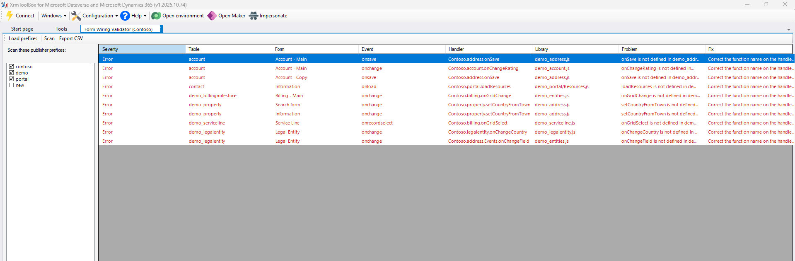

# Form Wiring Validator

An [XrmToolBox](https://www.xrmtoolbox.com/) tool that finds **broken form script wiring** in a
Dataverse / Dynamics 365 environment.

These problems are silent. The solution imports cleanly, nothing is logged, and the first
sign of trouble is an error dialog in a user's face — or a handler that simply never runs.

*Example output. Tick the publisher prefixes you want to scan, press Scan, and every handler that
cannot work is listed with the reason and the fix.*

## What it checks

| Check | Problem it catches |
|---|---|
| Function exists | A form calls `Namespace.doThing`, but the declared library does not define `doThing` |
| Library exists | A handler points at a web resource that is missing or empty |
| Library declared | A handler uses a library that is not in the form's library list |
| Execution context | The function reads the execution context, but the handler does not pass it — so the first argument is `undefined` and the script dies on its first line |
| Library order | A library uses something another library defines, but that one loads after it |
| Column exists | A control is bound to a column that no longer exists on the table |

Each check reads only what it needs to be sure. The execution context check, for instance, reads
that function's own body rather than searching the whole file, so another function using the same
parameter name cannot turn a working handler into a finding.

## Scope and noise

The hard part of a check like this is not the check — it is not drowning you in findings you cannot
act on.

Every environment carries hundreds of Microsoft's own forms whose scripts are bundled inside the
platform and cannot be resolved from a web resource. Business process flows have their own tables,
but their forms bind to columns of the table the process runs on, so every one of those columns
reads as missing. And `new` is the prefix Dataverse hands to the default publisher, so most of what
carries it was never deliberately built.

So the tool scans **your own publisher prefixes**, detected automatically and yours to tick or untick,
skips process and relationship tables when checking columns, and leaves `new` unticked to begin with.

On a real environment that took the first run from 107 findings to 10 — the same 10 real problems,
with the 97 that nobody could act on gone.

## Results

Findings are listed with the table, form, handler, library and the reason, and can be exported to CSV
so they can be pasted straight into a work item.

## Building

- Visual Studio 2022 or later
- .NET Framework 4.8
- `dotnet build` or build the solution, then copy the output DLL into the XrmToolBox `Plugins` folder

## Licence

MIT — see [LICENSE](LICENSE).
